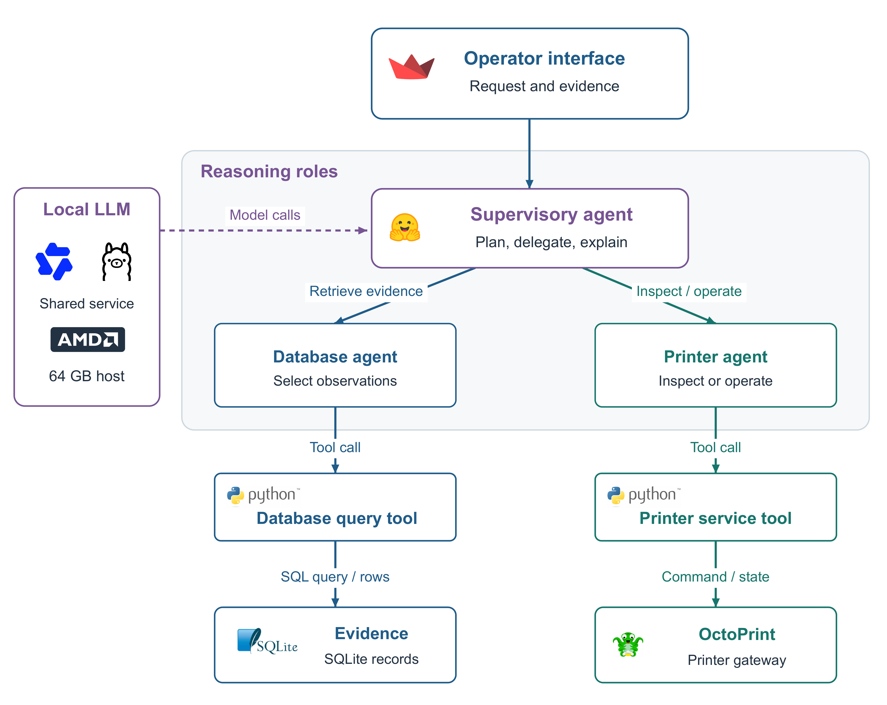
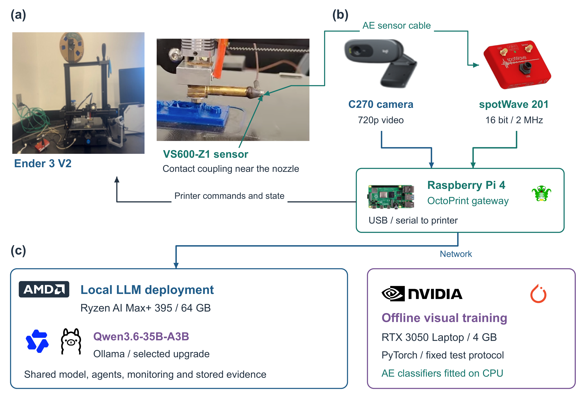
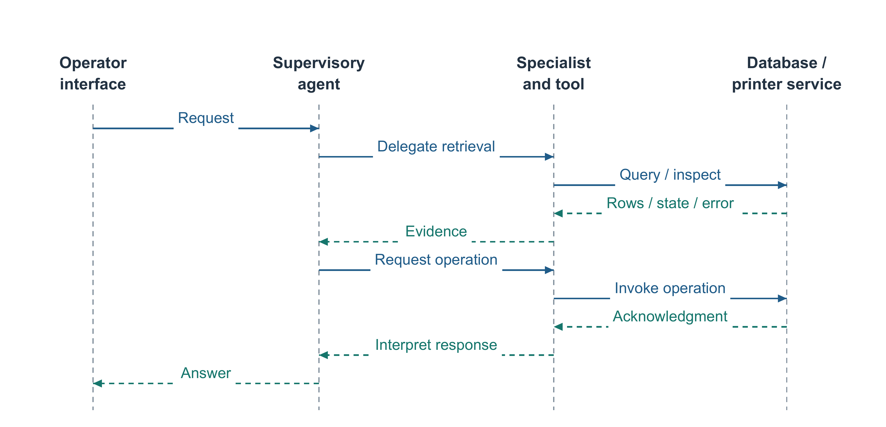
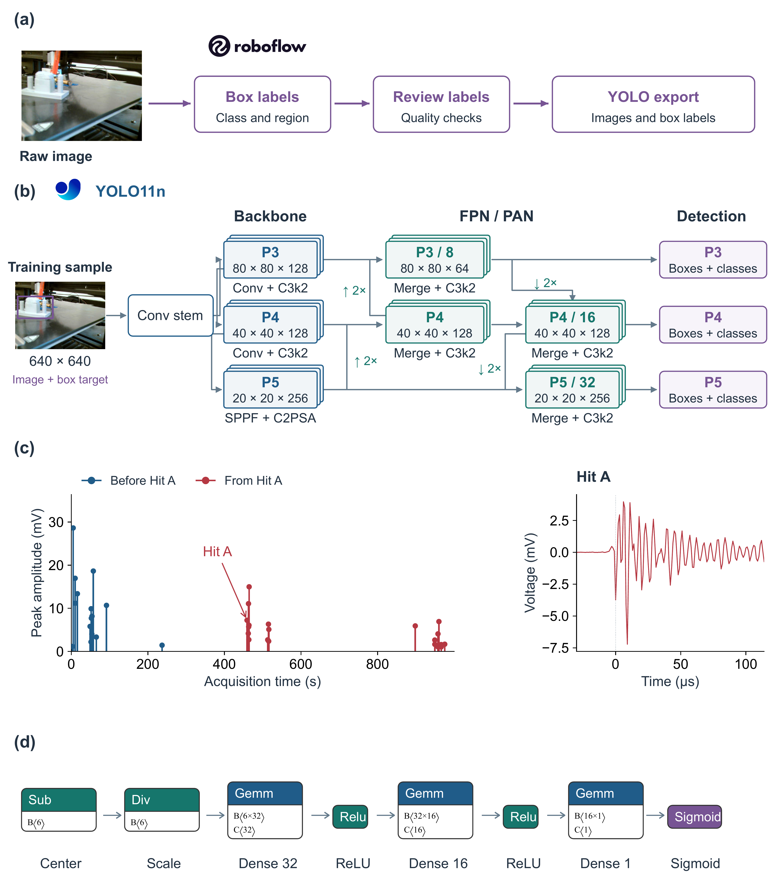
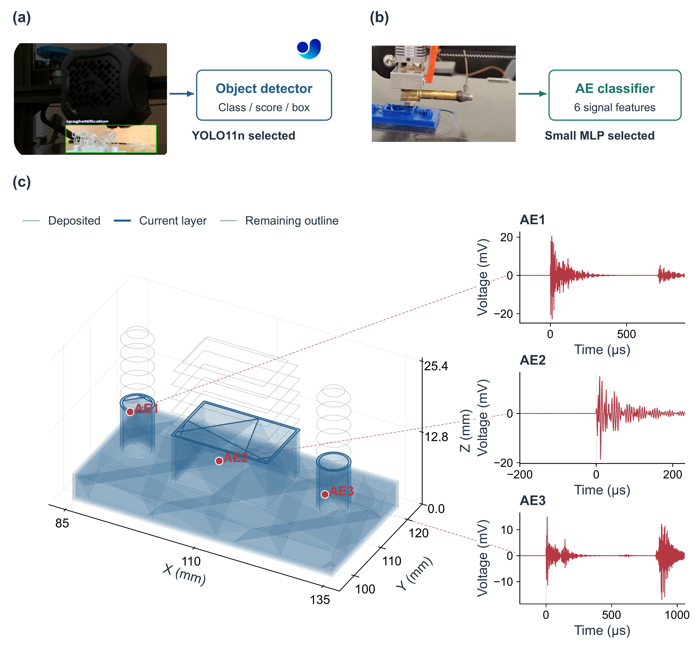
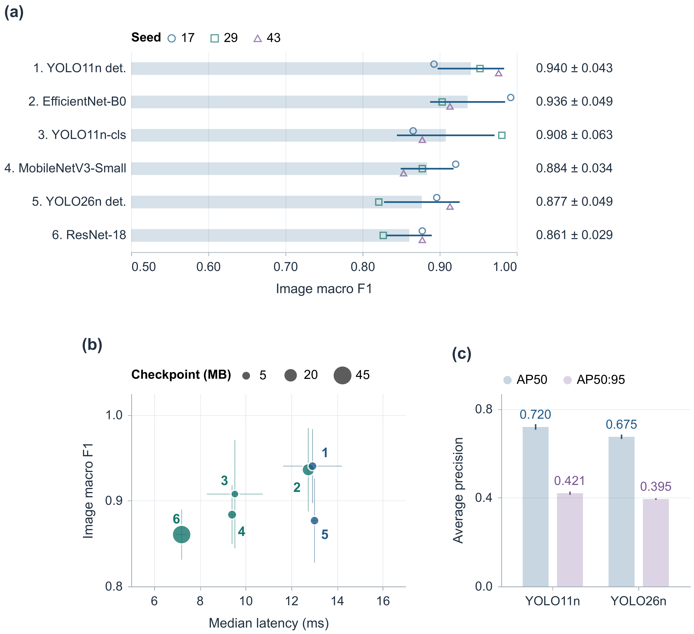
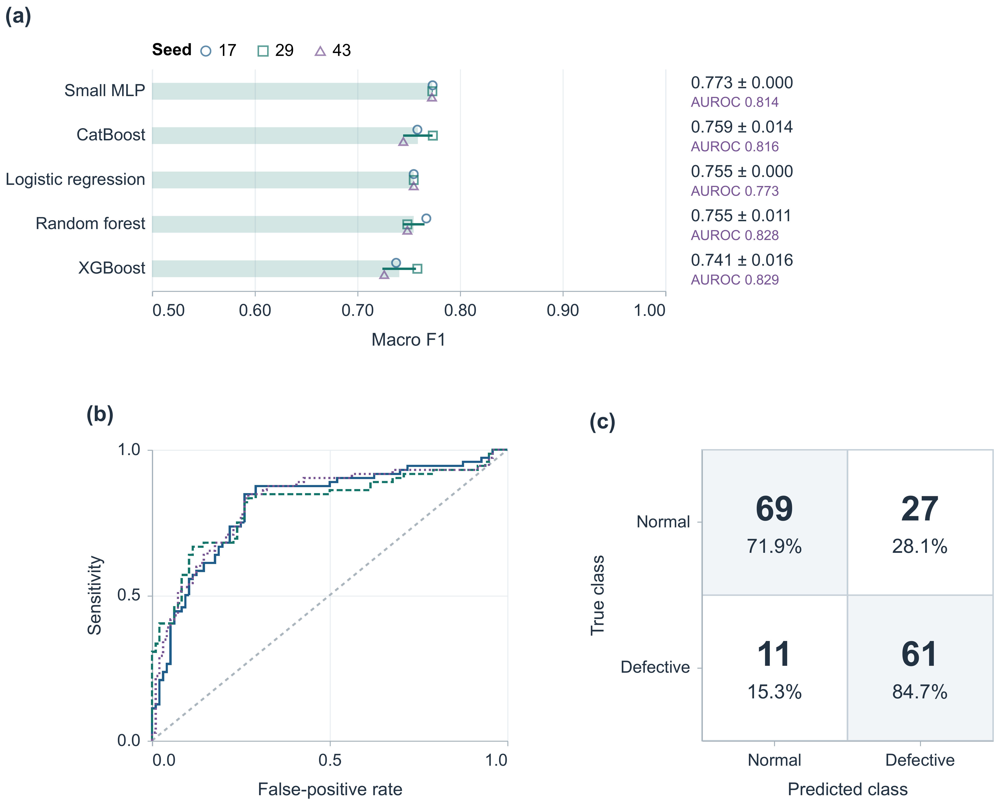
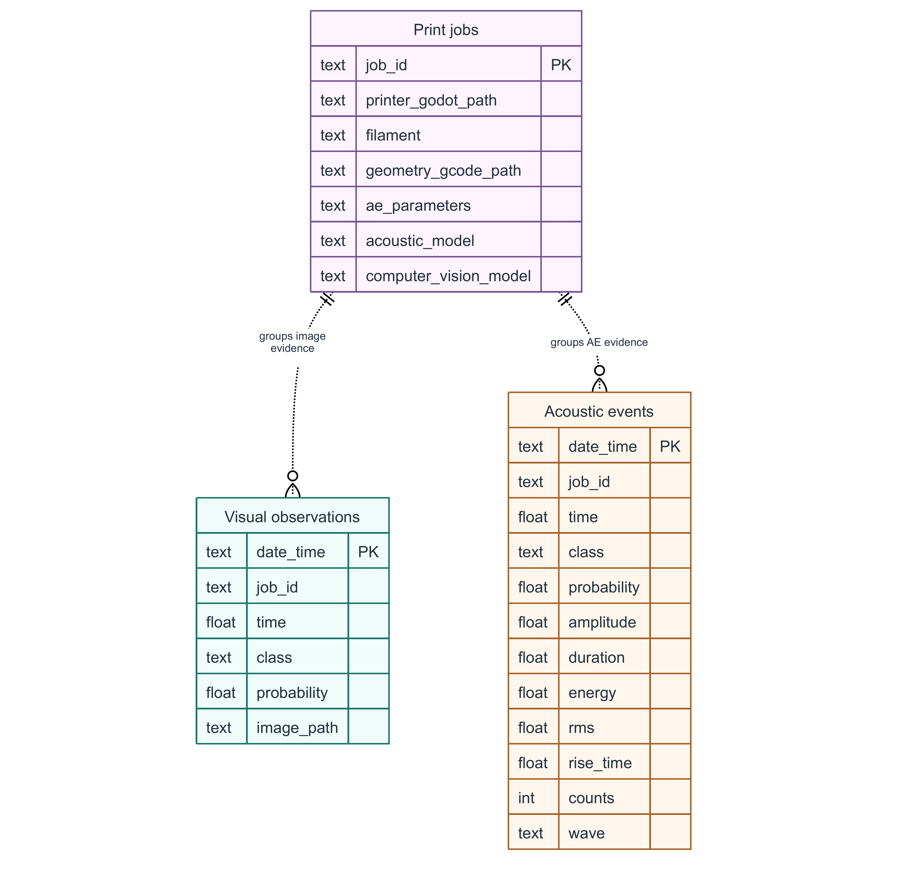

# Agentic multimodal monitoring for 3D printing

Reproducible evidence for a local language-model agent workflow in fused filament fabrication (FFF). This repository brings together the recognition benchmarks, experiment records, accepted journal figures, and revised manuscript. It links the original implementations rather than presenting their work as a new system built from scratch.

The main contribution is the supervisory workflow: an operator asks a question or requests an action, a supervisor delegates to a database or printing agent, and a registered tool returns records or an OctoPrint reply. Independent sensing services can request a pause without waiting for a language-model conversation.



## What is measured here

| Evidence | Available result | Scope |
| --- | --- | --- |
| Visual recognition | Six candidates, seeds 17, 29 and 43, 219 frozen test images | Temporal-overlap sensitivity comparison within three acquisition sequences |
| Acoustic emission (AE) recognition | Five feature classifiers, three fitting seeds, 168 frozen test rows | Row-level comparison; print-job identifiers are not available |
| Model selection | YOLO11n detection and a small AE multilayer perceptron (MLP) | Component selection, not complete system acceptance |
| Agent workflow | Source implementation, role and tool diagrams, evaluation protocol | No measured agent-task success rate in this release |
| Sensor association | Job/time/commanded-position architecture | No validated paired-sensor fusion score or AE triangulation |
| Synthetic fusion experiment | Separate, explicitly named simulation code and results | Software exploration only; not physical sensor validation |

Three fitting seeds measure variation on fixed data splits. They do not create three independent printers or print cohorts. A virtual-printer acknowledgment is not a measured physical stop. Real waveforms are used in the figures, but their illustrated positions on the G-code geometry are schematic.

## Original repositories and provenance

| Original project | Role in this work | Upstream HEAD checked on 13 October 2026 |
| --- | --- | --- |
| [MultiAgent SCADA](https://github.com/bensidhom/MultiAgent_SCADA) | Streamlit/smolagents application, SQLite retrieval, OctoPrint operations, local model service | `e69a80ade011e1d7d84b72861d7fffb3bb486eb5` |
| [AI-driven analytics and digital twins](https://github.com/bensidhom/Novel-Cyber-Infrastructure-Enabling-AI-Driven-Analytics-and-Digital-Twins-for-Real-Time-3D-Printing) | Camera monitoring, retained system examples and geometry resources | `d7de6fd25b700a9376ef7c8bdd79f97248f58d04` |
| [Acoustic emission monitoring at the edge](https://github.com/bensidhom/Acoustic-Emission-Monitoring-at-the-Edge-for-Real-Time-Artificial-Intelligence-Applications) | Archived AE feature table and acquisition resources | `64adbec266ee57bcff61cb88200a2f0a55486f29` |

These are current upstream references, not invented historical training commit IDs. Original run manifests retain the provenance actually recorded during the experiments, including missing Git revision values. `docs/export_inventory.json` records the local export and mechanical path redactions. Numerical observations and saved predictions are retained.

The older repositories remain credited sources. This repository is the consolidated location for the new benchmark evidence and manuscript revision; it does not silently replace their histories.

## Hardware and software responsibilities



| Component | Responsibility |
| --- | --- |
| Creality Ender 3 V2 | FFF printer in the retained physical setup |
| Logitech C270 | Color video source; rated 720p/30 fps is not the measured processing rate |
| Vallen VS600-Z1 and spotWave 201 | Contact AE sensing and single-channel acquisition; product ratings are not proof of each archived record's settings |
| Raspberry Pi 4 and OctoPrint | Printer connectivity, state and operations, data access |
| AMD Ryzen AI Max+ 395, 64 GB shared memory | Designated local LLM deployment host; acceptance measurements remain required |
| NVIDIA RTX 3050 Laptop GPU, 4 GB | Actual visual benchmark training/evaluation host |
| CPU fitted pipelines | Acoustic feature-model training and prediction benchmarks |

Qwen3.6-35B-A3B is the selected language-model upgrade through Ollama, not a measured winner on the manufacturing-agent tasks. The original application uses Qwen3-Coder 30B. Recognition scores do not establish LLM quality, AMD latency or memory acceptance. See the manuscript and `docs/EVIDENCE_REGISTER.md` for model-source links and deployment conditions.

## Agents are not tools or databases

The supervisor interprets the operator's request. The database agent prepares record queries. The printing agent prepares supported printer-service operations. Their local model service is shared.

The SQL tool checks syntax by parsing the statement before query execution; parsing is not an authorization policy. The printer wrapper calls OctoPrint with operation-specific inputs. SQLite, image files, waveform records and the printer controller are resources, not reasoning agents. Background monitoring is separate from the conversation.



Import limits and step limits are not operating-system sandboxes. Production integration needs independently enforced file/network/resource isolation and action authorization. Requests, controller acknowledgments and independently observed physical outcomes must be logged separately. This release does not certify autonomous printer operation as safe.

## Data and labeling



Roboflow labeling receives an unboxed camera image. Its reviewed output contains images, separate YOLO label files, and a dataset configuration. Each label gives a class ID and normalized box center, width and height. The training diagram's overlay illustrates a separate target, not a box painted into the model's pixel input. Detector inference receives an unboxed image and returns box coordinates, classes and confidence scores.

The visual comparison uses Clinic version 2 from [Roboflow](https://universe.roboflow.com/clinic-project-peqdq/clinic-3d-printing-defect-detect). The archive has 1,235 images and 1,658 object annotations. Background is an image-level category for empty labels, not a third defect-box class. The frozen purged split removes 88 boundary images and retains 728 training, 200 validation and 219 test images. Source groups and identical hashes do not cross the final splits. Class and acquisition sequence remain partly confounded.

The AE table in `data/recorded/ae_overflow.csv` contains 840 feature observations: 479 normal and 361 defective. Inputs are amplitude, duration, energy, root mean square amplitude, rise time and counts. The frozen stratified split is 504/168/168 rows. The separate archive of 35 waveforms is for recorded-event illustration; it has no verified row-to-waveform link and is not a synchronized companion to the vision test set.

External raw images and pretrained/checkpoint weights are deliberately not bundled. Obtain the exact dataset version through its authorized upstream access and check reuse conditions. Do not retrieve an API key from an old notebook: use your own `ROBOFLOW_API_KEY` environment variable. The external Hu dataset is a separate five-class source, not a valid direct accuracy test for the Clinic defect labels.

## Recorded signals and geometry



The geometry is reconstructed from the real rectangular-specimen G-code at layer 64/127, Z = 12.8 mm. The source is included as `data/recorded/specimen.gcode`, together with the 35-hit archive `ae_hits.tsv` and the plotted waveform CSVs. G-code is supplied for inspection, not automatic execution on a printer. The waveform axes use millivolts and microseconds. The 1 microsecond interval is inferred from the saved record structure and is distinct from the acquisition unit's rated 2 MHz capability. AE1–AE3 links are schematic commanded-position associations, not measured source locations. One contact sensor cannot triangulate a defect within the specimen.

The timeline in the model-workflow figure marks Hit A at 458.95 s. Blue means before Hit A and red means from Hit A onward. It does not establish defect onset: all 35 archived hits are labeled defective.

## Benchmark results

### Visual classification and detection



| Candidate | Image macro F1 | Box AP50 | Mean of run median time | Checkpoint |
| --- | --- | --- | --- | --- |
| YOLO11n detector | 0.940 ± 0.043 | 0.720 ± 0.013 | 12.9 ms | 5.5 MB |
| EfficientNet-B0 | 0.936 ± 0.049 | Not applicable | 12.7 ms | 16.3 MB |
| YOLO11n classifier | 0.908 ± 0.063 | Not applicable | 9.5 ms | 3.2 MB |
| MobileNetV3-Small | 0.884 ± 0.034 | Not applicable | 9.4 ms | 6.2 MB |
| YOLO26n detector | 0.877 ± 0.049 | 0.675 ± 0.010 | 13.0 ms | 5.4 MB |
| ResNet-18 | 0.861 ± 0.029 | Not applicable | 7.2 ms | 44.8 MB |

Values summarize seeds 17, 29 and 43; ± is sample standard deviation. YOLO11n is selected for its image-region output, not proven statistical superiority over EfficientNet-B0. Timings include image reading and processing on the NVIDIA benchmark host. AP measures object localization and cannot be substituted for image macro F1. RT-DETR's one-epoch feasibility run is excluded from the scientific ranking.

Full results: [shared endpoints](reports/tables/vision_task_multiseed.md), [classifier comparison](reports/tables/vision_classifier_multiseed.md), [detector comparison](reports/tables/vision_detector_architectures.md), and [split sensitivity](reports/tables/vision_split_sensitivity_seed17.md).

### Acoustic feature classification



| Candidate | Macro F1 | AUROC | Feature-ready prediction time |
| --- | --- | --- | --- |
| Small MLP | 0.773 ± 0.000 | 0.814 ± 0.004 | 0.201 ms |
| CatBoost | 0.759 ± 0.014 | 0.816 ± 0.002 | 0.241 ms |
| Logistic regression | 0.755 ± 0.000 | 0.773 ± 0.000 | 0.187 ms |
| Random forest | 0.755 ± 0.011 | 0.828 ± 0.002 | 49.261 ms |
| XGBoost | 0.741 ± 0.016 | 0.829 ± 0.003 | 0.334 ms |

The MLP is selected by macro F1; XGBoost has the highest descriptive mean AUROC. Decision thresholds use validation rows only. The seed-17 MLP confusion matrix contains 69 true normal, 27 false positive, 11 false negative and 61 true defective observations. Timings exclude acquisition and feature extraction. Rounded ±0.000 is not a claim of exactly zero variation. See [full acoustic results](reports/tables/ae_feature_benchmark.md).

## Reproduce and inspect the evidence

Use Python 3.12. The recorded training environment is in [configs/ENVIRONMENT.md](configs/ENVIRONMENT.md) and [configs/environment.lock.txt](configs/environment.lock.txt). The original visual runs used CUDA 12.8. Install PyTorch for your actual hardware from its official wheel source; the following CPU setup is sufficient for verification and AE work, not for reproducing original GPU timing.

```bash
python -m venv .venv
# Activate .venv using your operating system's normal command
python -m pip install -r requirements.txt
python -m pip install pytest
python scripts/verify_evidence.py
python -m pytest tests -q
```

To refit the acoustic models without overwriting the archived publication results:

```bash
python src/benchmark_ae_features.py --source data/recorded/ae_overflow.csv --output-root artifacts/ae_rerun
```

For vision, obtain the original export using your own authorized key. No key is stored in this repository:

```bash
python src/fetch_authorized_roboflow_export.py --output data/external/clinic_v2_yolov5 --metadata artifacts/clinic_download.json
python scripts/materialize_frozen_vision.py --images data/external/clinic_v2_yolov5
```

The materializer verifies image hashes against the frozen manifest, reconstructs separate labels from the recorded normalized boxes, and writes a machine-specific runtime manifest under `artifacts/`. It does not invent a new split or change the committed one.

Example YOLO11n seed-17 run; repeat with seeds 29 and 43 and the registered candidates:

```bash
python src/train_yolo_detector.py --model yolo11n.pt --data-yaml data/processed/clinic_v2_purged_detection/data.yaml --dataset-manifest artifacts/clinic_v2_runtime_manifest.csv --epochs 30 --patience 8 --imgsz 640 --batch 4 --workers 0 --device 0 --seed 17 --name clinic_v2_purged_yolo11n_detect_seed17
python src/select_detector_operating_point.py --model runs/detection/clinic_v2_purged_yolo11n_detect_seed17/weights/best.pt --data-yaml data/processed/clinic_v2_purged_detection/data.yaml --dataset-manifest artifacts/clinic_v2_runtime_manifest.csv --output runs/detection/clinic_v2_purged_yolo11n_detect_seed17/validation_operating_point --seed 17
```

Use the selected threshold from the validation operating-point report unchanged as `--confidence` with `src/evaluate_yolo_detector.py`. Its `--help` lists the remaining required arguments. Keep test labels out of checkpoint and threshold selection. Classifier training/evaluation entry points are `train_yolo_classifier.py`, `train_torchvision_classifier.py`, `evaluate_yolo_classifier.py` and `evaluate_torchvision_classifier.py`; their required arguments are documented through `--help`.

The report builders in `src/build_*report.py` aggregate saved run metrics and regenerate scientific benchmark plots. Original per-epoch `results.csv`, validation/test predictions and thresholds are committed under `runs/`. Checkpoints, fitting binaries and raw external datasets must be generated or obtained separately. Hardware/software differences can alter fitted results and timings.

## Repository map

```text
assets/figures/       Eight accepted high-resolution paper figures
configs/             Frozen model matrices and recorded environment
data/manifests/      Source, split, integrity and eligibility manifests
data/recorded/       Archived author-supplied AE feature table
docs/                Evidence register, provenance and revision notes
paper/               Revised Word manuscript and readable paragraph source
reports/metrics/     JSON/CSV machine-readable benchmark results
reports/tables/      Generated benchmark summaries
reports/figures/     Generated scientific benchmark plots
runs/                Saved training logs, predictions and operating points
scripts/             Verification and portable reconstruction utilities
src/                 Actual preparation, fitting and evaluation code
tests/               Adapter, threshold and publication-integrity tests
artifacts/           Ignored local reruns and machine-specific outputs
```

## Database design



Keep print-job context, image-level records, individual detections, acoustic features and waveforms distinct. A missing detection row is not a normal observation. The diagram is the planned job linkage; it does not by itself establish that all foreign-key constraints are enforced in the original SQLite application. Event acquisition time, host receipt time and insertion time need separate fields for synchronized association.

## Manuscript and revision policy

The [readable full manuscript](paper/manuscript.md) and paragraph revision log are in `paper/`. The Markdown version includes all eight figures, eight tables and the equations. The edited Word version is held locally until its page-by-page layout verification is complete. The original local drafts are preserved outside this publication tree. The revision keeps the accepted figures and numerical tables, corrects citation punctuation and reference typography, restores precise consecutive-event and target-temperature wording, and replaces the repository placeholder with this real repository URL. The three original repository links remain in Data and code availability, without inline self-repository author-date citations.

Before journal submission, the authors must confirm affiliations, corresponding-author details, declarations, image/logo reuse permissions and the remaining system-validation claims. The release is an evidence package and manuscript, not an assertion that every architectural requirement has been physically validated.

## Reuse and security

See [NOTICE.md](NOTICE.md) for attribution and reuse conditions. Third-party dependencies keep their own licenses; logos and marks identify products and do not imply endorsement. No blanket license for all code, datasets and artwork is inferred here. Raw external datasets are accessed upstream under their own terms.

Never commit API keys, passwords, printer endpoints containing credentials, signed download links, private host paths or notebooks with embedded secrets. Generated Python and printer operations need a separately tested security boundary. See [docs/REPRODUCIBILITY.md](docs/REPRODUCIBILITY.md) for what this release can and cannot reproduce.
